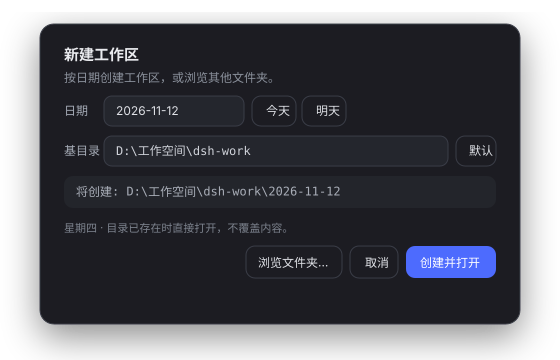
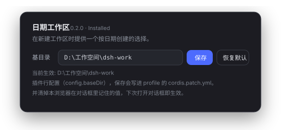

# dsh-date-workspace

给 [DeepSeek Harness](https://github.com/deepseek-ai/deepseek-harness)（DSH）网页 GUI 加一个**「日期工作区」**选项：
新建工作区时不再只有「浏览文件夹」一条路，而是弹出一个带日期选择的小窗，一键在 `D:\工作空间\dsh-work`
下创建（或复用）`YYYY-MM-DD` 目录并直接打开。



```
点 ⊕ / 添加工作区…  →  [新建工作区] 选日期、改基目录  →  创建并打开
```

## 功能

- **日期工作区**：默认今天、可 `今天/明天` 切换或自选日期，路径实时预览。
- **逐级建目录**：`D:\工作空间` → `dsh-work` → `2026-11-12`，缺哪级建哪级，已存在就跳过。
- **幂等**：日期目录已存在时直接登记并打开同一个工作区（等于「回到今天的工作区」），不覆盖内容。
- **保留原生选择**：对话框里的「浏览文件夹…」仍走 Host 原来的原生选目录实现。
- **可配置基目录**：对话框里改一次，记在 `localStorage`（键 `dsh-date-workspace:base`）。
- **可随时摘掉**：低优先级影子注册，禁用插件即恢复原生交互，不用改组合配置。

## 安装

DSH 的工作区选择由 `@deepseek-ai/dsh-client-ui-workspace` 声明的两个 *directory-flow* 槽位驱动
（`sidebar.workspaces.directoryFlow`、`conversation.hero.workspace.directoryFlow`）。本包以
`priority: -1` 注册进这两个洞——槽位规则是「同优先级重复注册报错、低优先级渲染」——于是自己渲染，
原生占位者（priority 0）继续留在图上作为 fallback。

两种装法，**任选其一**，不要同时用（同一个 id 会被插两次）：

### A. 当 bundle 装（推荐给他人）

```bash
dsh plugin --profile <profile> add <本仓库地址或 npm 包名>
```

`cordis.patch.yml` 会把插件行插进组合树；重启 DSH、刷新页面即可。

### B. 手动装（开发/本地）

```powershell
# 1) 把包挂到 profile 的 node_modules
New-Item -ItemType Junction `
  -Path  "$env:DSH_HOME\profiles\<profile>\node_modules\dsh-date-workspace" `
  -Target "<本仓库路径>"

# 2) 在 profile 的 cordis.patch.yml 顶部插入插件行（config 可选）
#    - insert:
#        - id: date-workspace
#          name: dsh-date-workspace
#          config:
#            baseDir: D:\工作空间\dsh-work
```

profile 的这一层是热重载的，插件行立即激活；**刷新一次页面（Ctrl+R）** 就能看到新对话框。
行里带了 `config` 的话，Host 半边需要**重启一次 DSH** 才会把 `baseDir` 注入页面。

## 使用

1. 侧边栏工作区标题栏的 ⊕，或会话首页工作区菜单里的「添加工作区…」。
2. 选日期（默认今天），需要的话改基目录。
3. `创建并打开`：建目录 → 登记工作区 → 开一个新会话。

日期目录已存在时行为等价于打开该工作区；工作区标题默认取目录名（即日期）。

## 在 GUI 里改基目录（推荐）

装成 bundle 后，插件会出现在侧边栏 **Plugins → Installed plugins** 里，卡片本身就是配置页：



1. 侧边栏点 **Plugins**，在 **Installed plugins** 找到 **dsh-date-workspace / 日期工作区**；
2. 点进卡片，**基目录** 一栏填新路径，点 **保存**；
3. 保存会写进 profile 的 `cordis.patch.yml`（`- id: date-workspace` 的 `config.baseDir`），
   同时清掉本浏览器在对话框里记住的旧值，**无需重启**，下次打开对话框就是新目录。

**恢复默认** 会删掉这条 override，回落到插件自带的 `D:\工作空间\dsh-work`。

> 为什么以前在 Plugins 里查不到：之前是手工往 profile patch 里插的一行裸插件（只存在于 Loader 树里，
> 不在 `dsh.profile.bundles` 里），插件管理页只认 bundle。现在包自带 `cordis.patch.yml` 并登记进
> `dsh.profile.bundles`，所以它是可管理的 bundle，并且能带自己的配置页（`plugins.bundle.config` 槽位）。

## 配置

基目录是**插件行配置**，不是写死的常量。三层来源，优先级从高到低：

| 层 | 怎么设 | 生效范围 |
| --- | --- | --- |
| 对话框记忆值 | 在对话框里改「基目录」，存进 `localStorage['dsh-date-workspace:base']` | 当前浏览器/设备 |
| 插件行 config | GUI 设置页保存，或手改 profile patch 的 `config.baseDir`；Host 启动时注入 `globalThis.__DSH_DATE_WORKSPACE__`，并随 volatile 引用热更新 | 所有页面 |
| 内置默认 | `lib/index.js` 的 `Config.baseDir` 默认值 = `D:\工作空间\dsh-work` | — |

装好后在 profile 的 `cordis.patch.yml`（或 bundle 层的同一行）按 id 补 `config`：

```yaml
- id: date-workspace
  config:
    baseDir: E:\工作空间\dsh-work
```

- `baseDir` 是 **volatile** Config 字段：GUI 保存或手改 patch 都会即时应用到运行中的 Host（profile 开着 HMR 时），
  不需要重启；改 `lib/index.js` / `lib/client.js` 的代码才需要重启 / 刷新。
- 对话框里的「默认」按钮会清掉浏览器记忆值，立刻回落到行配置。
- 目录名格式由 `lib/client.js` 的 `todayISO()` / `addDays()` 决定，目前是 `YYYY-MM-DD`。

## 实现

- `lib/index.js`：`Config = z.object({ baseDir: z.string().default(...).volatile() })`；Host 半边在
  `webserver/index-inject` 里推一行 `{ kind: "global", name: "__DSH_DATE_WORKSPACE__", value: { baseDir } }`，
  每次渲染 index 都从 volatile 引用读当前值 → 页面里就是 `globalThis.__DSH_DATE_WORKSPACE__`。
- `lib/client.js`：手写的 Module Loader bundle（`window.__ModuleLoader__.load({ id, factory })`），
  依赖仅 `react` / `react-dom`（静态模块表内），无需编译即可被 `/plugins/dsh-date-workspace/client.js` 提供。
  它注册三样东西：
  1. 两个 workspace directory-flow 洞的日期对话框（`priority: -1` 影子注册）；
  2. `plugins.bundle.config`（key `dsh-date-workspace`）的设置页，读写走 `ctx.configForms.get('date-workspace')`
     （即 Host settings 命名空间，写入落在 profile patch）；
  3. 一个 mirror 订阅，把设置页的最新值同步进 `globalThis.__DSH_DATE_WORKSPACE__`，对话框立刻用新目录。
- 建目录复用 `ctx.uiWorkspace.createDirectory(parent, name)`（Host 侧 `mkdir`，`EEXIST` → `directory-exists`）；
  选目录复用 `ctx.uiWorkspace.pickDirectory()`。
- 对话框拿 owner 传来的 `open / busy / onPicked / onCancel`，自己只负责算路径、建目录、回报一个路径。

## 开发

```bash
npm test        # node tests/smoke.mjs && node tests/host.mjs
```

- `tests/smoke.mjs`：桩 `react`/`react-dom` 与桩槽位注册器跑整个 client factory，覆盖 bundle 注册 id、
  `inject` 服务表、两个洞的 priority -1 注册、设置页注册与 mirror 同步、分段建目录顺序、`directory-exists`
  容忍、真实错误透传、基目录三层优先级与「默认」按钮、两个组件渲染。
- `tests/host.mjs`：桩 ctx 跑 Host 半边，覆盖 `Config` 默认值、行配置发布、空白/缺失回落、trim、
  以及 volatile 引用的实时读取。

改了 `lib/client.js` 后：client-modules 按 mtime 计算 revision，刷新页面即加载新版本。改了
`lib/index.js`：重启 DSH。

## 卸载

1. 侧边栏 **Plugins → 日期工作区 → Remove**（或把本包从 profile 的 `dsh.profile.bundles` 去掉）。
2. 删除 junction（手动装法）。
3. 刷新页面——原生选择器回来。

## 兼容性

- DSH `0.2.2-rc.1` 的 web / desktop profile（`dsh.client` + client-modules + `sidebar.workspaces.directoryFlow`）。
- 依赖的槽位与 `ctx.uiWorkspace` 方法都是该版本的公开面；DSH 大改槽位契约时需同步更新。

## License

MIT
